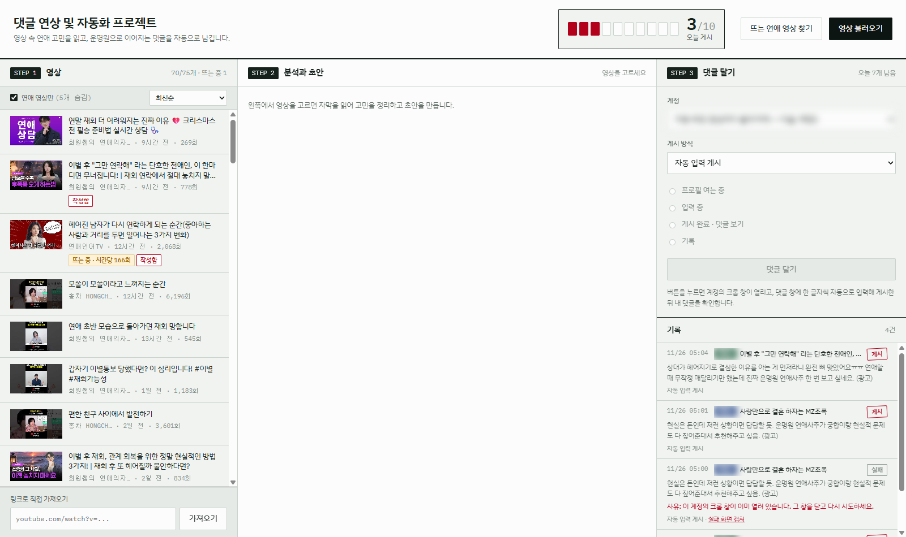
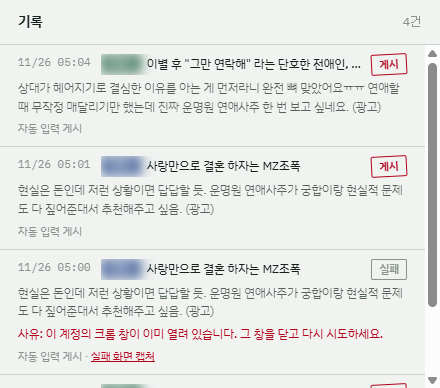
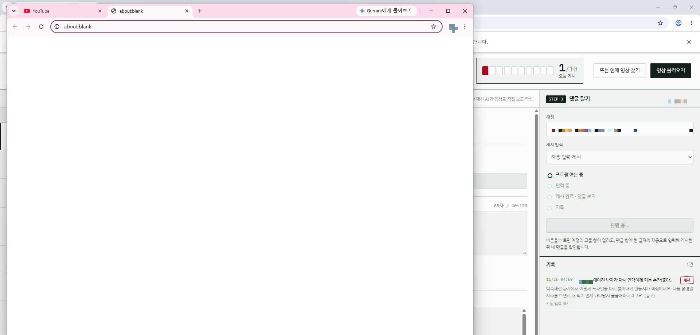

# 댓글 연상 및 자동화 프로젝트

유튜브 연애 상담 영상을 보고, 시청자처럼 자연스러운 댓글을 써서 올려 주는 도구입니다.



## 어떻게 동작하나요

1. **영상 고르기**: 관심 채널의 최신 영상이나 요즘 뜨는 연애 영상을 고릅니다. 링크를 직접 넣어도 됩니다.
2. **댓글 쓰기**: AI가 영상 내용과 인기 댓글을 읽고 시청자가 어떤 고민을 하는지 파악한 뒤, 그 장면을 짚는 댓글 초안을 씁니다.
3. **댓글 올리기**: 계정을 골라 크롬 창에서 한 글자씩 입력해 게시하고, 실제로 올라갔는지 확인해 기록으로 남깁니다.

## 지키는 규칙

- 댓글은 40~120자, 링크·해시태그는 넣지 않습니다.
- 써 보지 않은 서비스의 후기를 지어내지 않고, 광고라는 표시를 꼭 붙입니다.
- 한 영상에는 댓글 1개, 하루에는 최대 10개까지만 올립니다.
- 규칙에 어긋나면 게시 버튼이 꺼집니다.
- 올린 댓글은 성공이든 실패든 모두 기록하고, 실패하면 이유와 화면 캡처를 남깁니다.



게시에 실패하면 그 순간의 화면이 자동으로 저장됩니다. 아래는 같은 계정의 크롬 창이 이미 열려 있어서 게시하지 못했을 때의 화면입니다.



## 실행

```powershell
python -m venv .venv
.\.venv\Scripts\python.exe -m pip install -e .
.\.venv\Scripts\python.exe -m app.server   # http://127.0.0.1:8000
```

AI 키가 없으면 체험용 데모로 동작합니다.

설계 내용은 [docs/제작의도.md](docs/제작의도.md)에 있습니다.
